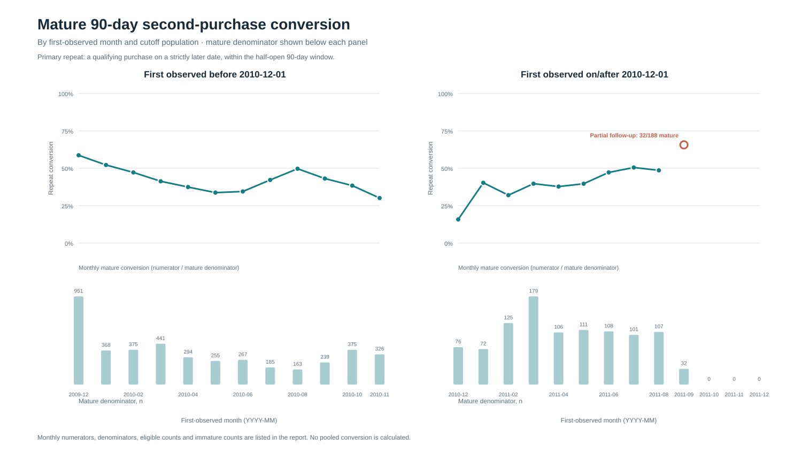
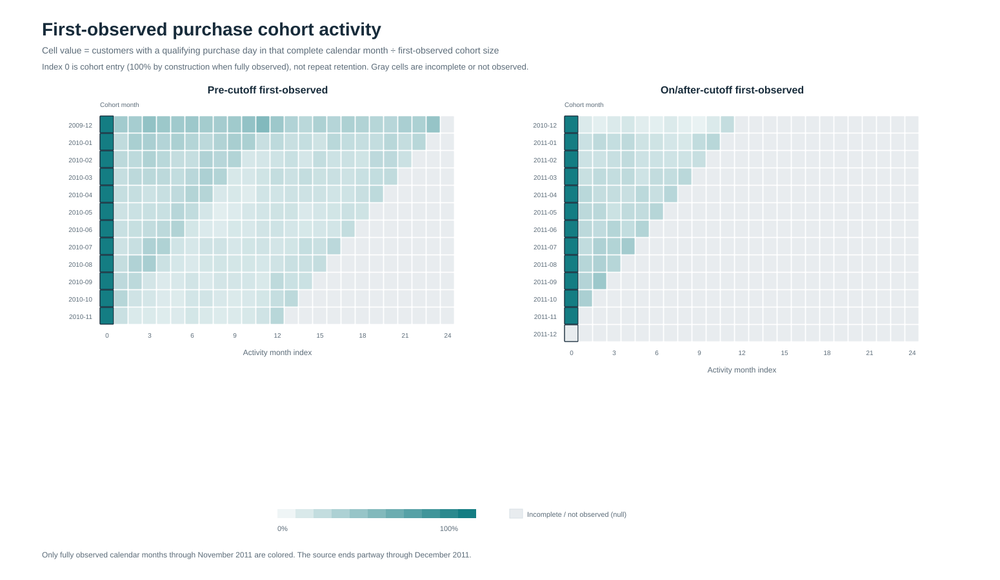
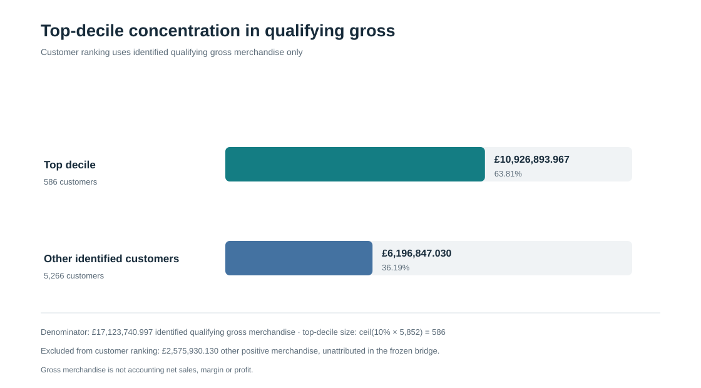
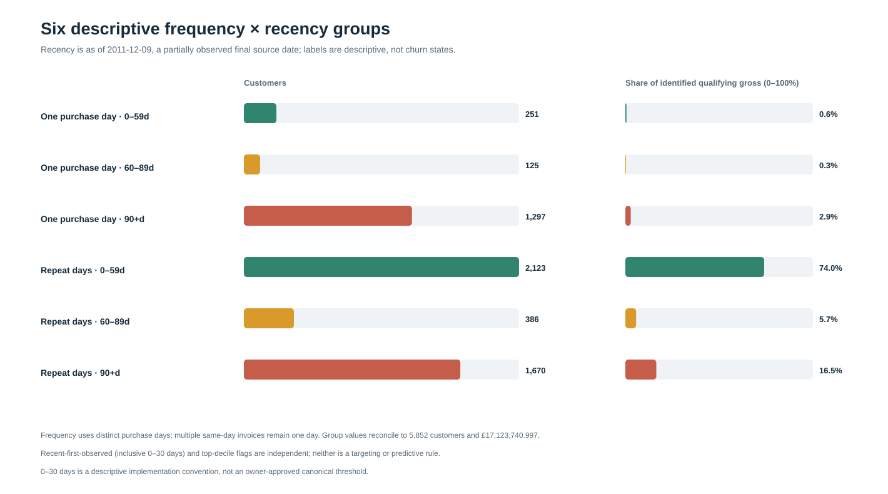

# Commercial Retention Analytics

A reproducible customer-behaviour and commercial analytics case study using corrected UCI Online Retail II transaction data. It asks: **How can a retailer understand repeat purchasing, customer concentration and observed customer activity without mistaking incomplete follow-up for churn?**

The corrected-V2 analysis is complete and independently reviewed. It links audited transaction rows to validated purchase occasions, censoring-aware outcomes and aggregate results. Earlier exploratory models, SQL/dbt work and dashboards are not part of this release.

## What I built

- Audited source duplication and removed only the reviewed overlap block, with pinned inputs, taxonomy validation and row/value reconciliation.
- Built validated customer metrics, purchase occasions, maturity-aware repeat outcomes and first-observed cohorts.
- Analysed gross concentration, an unlinked signed merchandise sensitivity and six descriptive customer groups.
- Added deterministic reconciliation, 15 focused tests and a reproducible aggregate report with four figures.

## Verified findings

- **5,852** identifiable qualifying customers; **36,594** customer-by-invoice occasions from **788,127** qualifying merchandise lines.
- **£17,123,740.997** identified qualifying gross merchandise.
- The top **586** customers contribute **63.8114%** of identified qualifying gross.
- **5,256** customers have mature 90-day follow-up; **596** have insufficient follow-up. Repeat results are reported by first-observed month and pre-/on-or-after-2010-12-01 population, with each stratum’s repeat numerator and mature denominator. **No pooled 90-day repeat rate is headlined.**
- Among customers with repeat observed purchase days, **2,123** whose last observed purchase was within 59 days of the partial 2011-12-09 data end account for **73.99%** of identified qualifying gross. This is a retrospective description of observed activity, not a prediction or targeting result.
- **£16,410,709.747** unlinked signed merchandise-line sensitivity across 5,875 identified customers, including 23 returns-only customers. It combines qualifying gross and identified merchandise returns/cancellations, which are not linked to original invoices; it is not accounting net sales or profit.

Other positive merchandise of £2,575,930.130 is not attributable to an identified customer in the source reconciliation, excluded from customer measures and not allocated. See the [scientific results report](reports/corrected_v2/corrected_v2_scientific_results.md) for definitions and full monthly results.
Qualifying gross is a merchandise measure, not recognized accounting revenue, margin or profit.

## Visual findings

All charts use aggregate corrected-V2 results. Gray cohort cells are incomplete or unobserved, not zero.

**Mature 90-day repeat conversion** — monthly strata are separated by first-observed population; the plot shows mature denominators and marks partial September follow-up.



**First-observed cohort activity** — month 0 is cohort entry, not repeat retention; later activity is shown only for complete calendar months.



**Qualifying gross concentration** — customer ranking uses identified qualifying gross; unattributed merchandise is disclosed outside the denominator.



**Descriptive frequency × recency groups** — six mutually exclusive groups, not churn predictions or CRM recommendations.



## Method and implementation

The corrected source removes only the reviewed 22,523-row overlap block between Online Retail and Online Retail II, retaining other repeated rows. Reference hashes validate the corrected source, taxonomy, qualifying occasions and signed-line reconciliation. A purchase occasion groups qualifying positive merchandise lines by identified customer and invoice; distinct purchase days remain separate from invoice counts.

A 90-day repeat requires a qualifying purchase on a strictly later date within the half-open window. Only customers with a complete follow-up window enter the denominator; immature outcomes remain unknown. Cohorts use first-observed month, not acquisition date, and only fully observed calendar activity months are counted. The last complete month is November 2011.

Customer concentration uses exact Decimal qualifying gross. The separate signed sensitivity adds identified merchandise returns/cancellations without invoice matching. Descriptive segments cross purchase-day frequency with recency as of the partial 2011-12-09 source end. None of these first-observed, recency or segment labels establishes acquisition, churn risk or treatment eligibility.

The current corrected-V2 path is **Python 3.11 and pandas**, with Decimal monetary reconciliation, pinned references and deterministic validation. Fifteen focused tests cover metrics, censoring, reconciliation and segments; run them without raw data using `.venv/bin/python -m unittest discover -s docs/recovery -p 'test_COMMERCIAL_DS_007*.py'`. Earlier exploratory SQL/dbt, Spark, notebook and dashboard work is not included in this repository. No Tableau deployment, production service, executed CRM campaign or deployed AI system is claimed.

## Reproduce

To render the report and four figures from verified aggregate outputs, run from the repository root:

```sh
PYTHONDONTWRITEBYTECODE=1 .venv/bin/python docs/recovery/COMMERCIAL_DS_007D_PACKAGE.py \
  --input-dir data/processed/corrected_v2_customer_analytics \
  --output-dir reports/corrected_v2
```

To rebuild those aggregates, first obtain the exact pinned files `data/raw/Online Retail.xlsx` and `data/raw/online_retail_II.csv`; raw files are not in Git. Verify hashes in [data provenance](docs/DATA_PROVENANCE.md), set up the supported environment, and run:

```sh
python3.11 -m venv .venv
.venv/bin/python -m pip install -r requirements-minimal.txt
PYTHONDONTWRITEBYTECODE=1 .venv/bin/python docs/recovery/COMMERCIAL_DS_007B_CUSTOMER_ANALYTICS.py
PYTHONDONTWRITEBYTECODE=1 .venv/bin/python docs/recovery/COMMERCIAL_DS_007C_VALUE_SEGMENTS.py
PYTHONDONTWRITEBYTECODE=1 .venv/bin/python docs/recovery/COMMERCIAL_DS_007D_PACKAGE.py --input-dir data/processed/corrected_v2_customer_analytics --output-dir reports/corrected_v2
```

The exact Online Retail II CSV acquisition/conversion is not packaged as a script; a different conversion may not match the pinned input. See the [results reproduction guide](reports/corrected_v2/README.md) for aggregate schemas and source commits. Customer-level outputs stay under ignored `data/processed/`.

## Limitations

This is observational data from December 2009 through a partial December 9, 2011. Earlier customer history is left-censored; incomplete follow-up is handled explicitly. First-observed customers are not verified acquisitions. Unattributed activity is excluded from customer attribution, and returns/cancellations are unlinked. Segments are descriptive, not validated churn states. The inclusive 0–30-day recent-first-observed flag is a descriptive convention, not a validated CRM threshold or predictive feature. CRM intervention ideas remain proposed; no CRM experiment was executed.

## Repository map

- `docs/recovery/` — validated source, occasion and bridge contracts; customer-metric and segment scripts with tests; results-package builder.
- `reports/corrected_v2/` — scientific report, reproduction guide and four SVG charts.
- `docs/DATA_PROVENANCE.md` — source attribution and integrity pins.
- `reports/corrected_v2/README.md` — current results-package reproduction guide.

UCI Online Retail and Online Retail II datasets are attributed under CC BY 4.0; see [data provenance and attribution](docs/DATA_PROVENANCE.md). Project code is MIT-licensed; dataset and dependency terms are separate.
