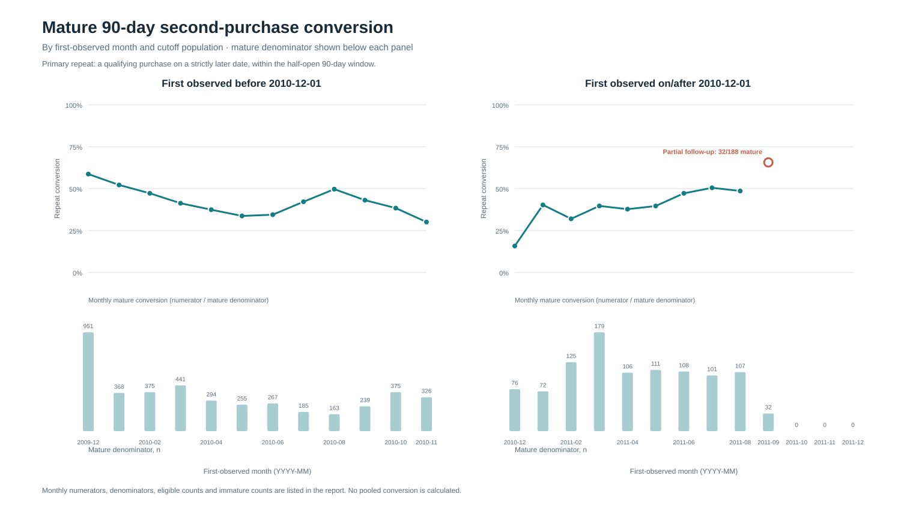
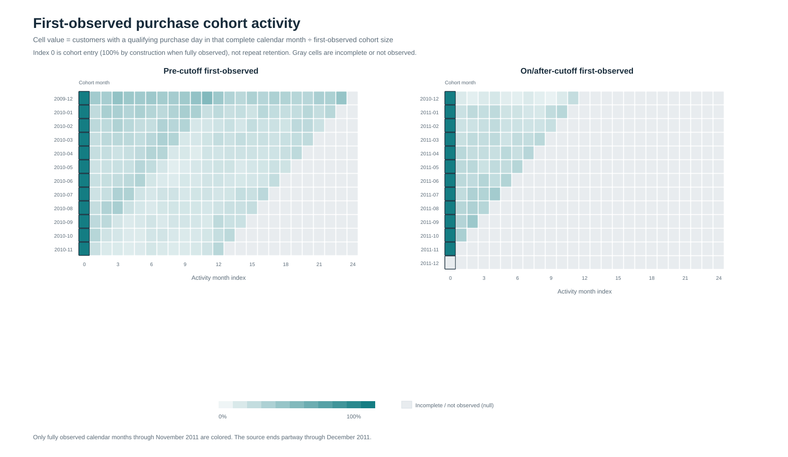
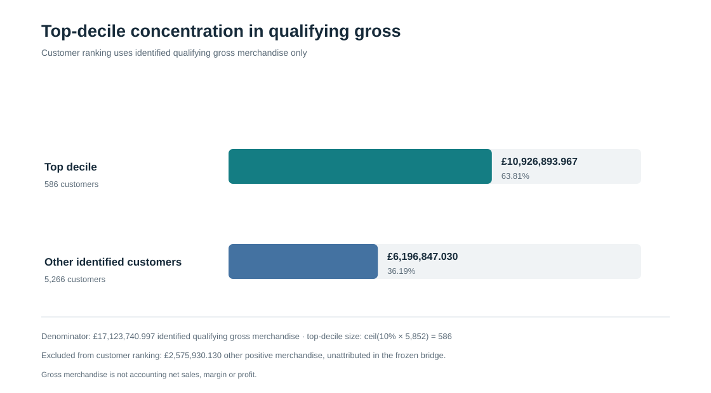
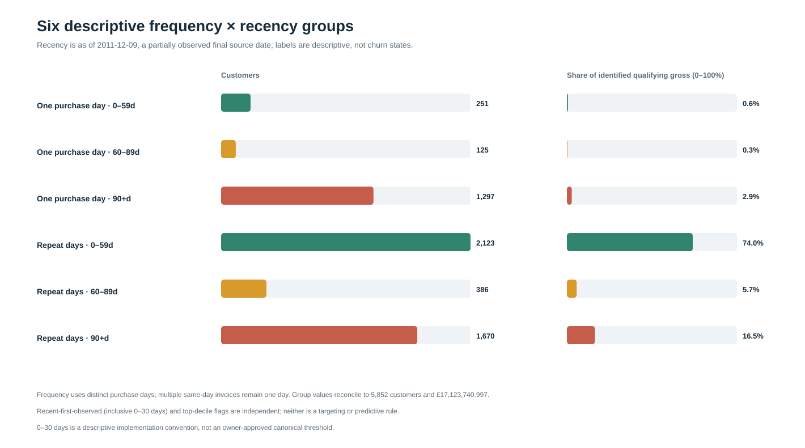

# Corrected-V2 Customer Analytics: Scientific Results

## Scope and data foundation

This report presents the accepted corrected-V2 customer analytics only. It uses the frozen corrected-V2 source and taxonomy through the validated purchase-occasion API. A purchase occasion is a qualifying customer × invoice event; repeat behavior is measured by distinct qualifying purchase dates. Monetary values use exact Decimal amounts.

The corrected source contains 1,044,848 rows. The accepted qualification yields 788,127 qualifying merchandise lines, 36,594 purchase occasions and 5,852 identifiable customers. Identified qualifying gross merchandise is **£17,123,740.997**.

Other positive merchandise of **£2,575,930.130** is unattributed in the frozen bridge and is excluded from customer-level value and concentration. It is disclosed separately and is not allocated to customers. Qualifying gross merchandise is not accounting revenue, net sales, margin or profit.

## 90-day second-purchase outcomes

The event is a qualifying purchase on a strictly later calendar date, within the half-open 90-day window (day +89 included; day +90 excluded). A customer is mature only if first-observed date + 90 days is on or before 2011-12-09. Immature outcomes remain unknown, not non-repeat. Results are stratified by first-observed month and by the pre-/post-2010-12-01 first-observed split. These populations are not verified acquisition cohorts.

No pooled 90-day repeat rate is reported. The table gives eligible customers, mature denominators, mature repeat numerators, conversion within mature strata, and insufficient-follow-up counts.

| First-observed month | Population | Eligible | Mature denominator | Repeat numerator | Conversion among mature | Insufficient follow-up |
|---|---|---:|---:|---:|---:|---:|
| 2009-12 | Pre-cutoff | 951 | 951 | 558 | 58.68% | 0 |
| 2010-01 | Pre-cutoff | 368 | 368 | 192 | 52.17% | 0 |
| 2010-02 | Pre-cutoff | 375 | 375 | 177 | 47.20% | 0 |
| 2010-03 | Pre-cutoff | 441 | 441 | 182 | 41.27% | 0 |
| 2010-04 | Pre-cutoff | 294 | 294 | 110 | 37.41% | 0 |
| 2010-05 | Pre-cutoff | 255 | 255 | 86 | 33.73% | 0 |
| 2010-06 | Pre-cutoff | 267 | 267 | 92 | 34.46% | 0 |
| 2010-07 | Pre-cutoff | 185 | 185 | 78 | 42.16% | 0 |
| 2010-08 | Pre-cutoff | 163 | 163 | 81 | 49.69% | 0 |
| 2010-09 | Pre-cutoff | 239 | 239 | 103 | 43.10% | 0 |
| 2010-10 | Pre-cutoff | 375 | 375 | 144 | 38.40% | 0 |
| 2010-11 | Pre-cutoff | 326 | 326 | 98 | 30.06% | 0 |
| 2010-12 | On/after cutoff | 76 | 76 | 12 | 15.79% | 0 |
| 2011-01 | On/after cutoff | 72 | 72 | 29 | 40.28% | 0 |
| 2011-02 | On/after cutoff | 125 | 125 | 40 | 32.00% | 0 |
| 2011-03 | On/after cutoff | 179 | 179 | 71 | 39.66% | 0 |
| 2011-04 | On/after cutoff | 106 | 106 | 40 | 37.74% | 0 |
| 2011-05 | On/after cutoff | 111 | 111 | 44 | 39.64% | 0 |
| 2011-06 | On/after cutoff | 108 | 108 | 51 | 47.22% | 0 |
| 2011-07 | On/after cutoff | 101 | 101 | 51 | 50.50% | 0 |
| 2011-08 | On/after cutoff | 107 | 107 | 52 | 48.60% | 0 |
| 2011-09 | On/after cutoff | 188 | 32 | 21 | 65.62% | 156 |
| 2011-10 | On/after cutoff | 221 | 0 | 0 | — | 221 |
| 2011-11 | On/after cutoff | 191 | 0 | 0 | — | 191 |
| 2011-12 | On/after cutoff | 28 | 0 | 0 | — | 28 |

Across the month strata, 5,256 customers are mature and 596 have insufficient follow-up. Do not interpret first observation as acquisition.

**Figure 1.** Conversion is plotted only where the mature denominator is nonzero; gaps are not imputed. Denominator bars are shown below each panel. Monthly numerators and denominators are in the table above.

## First-observed cohort activity

Customers are assigned to the month of their first observed qualifying purchase, not an acquisition date. Each later cell is the fraction of that first-observed cohort with at least one qualifying purchase day in the full calendar activity month. The denominator is the cohort size. There are 300 fully observed cells and 325 incomplete/future cells in the saved grid.

Month 0 is cohort entry, not repeat retention; for fully observed month-0 cells the activity fraction is 100% by construction. The December 2011 cohort's month-0 cell remains null because that calendar month is incomplete. The final complete activity month is November 2011; December 2011 and future cells are null/not observed, never zero. The observation window starts on 2009-12-01, so earlier customer history is left-censored; first-observed cohorts are not acquisition cohorts.

**Figure 2.** Heatmap color shows activity only for fully observed calendar months through November 2011. Gray cells are incomplete or not observed. The month-index 0 column is explicitly marked as cohort entry; the incomplete December 2011 cohort's month-0 cell is also null.

## Revenue concentration

The top **586 of 5,852** customers by qualifying gross merchandise account for **£10,926,893.967** of **£17,123,740.997** identified qualifying gross, a **63.8114%** share. The top-decile size is ceil(10% × eligible customers); rank order is gross descending with canonical customer ID ascending for ties.

Unattributed other positive merchandise (**£2,575,930.130**) is excluded from customer ranking and remains disclosed in the source bridge.

**Figure 3.** The denominator contains identified qualifying gross merchandise only. Other positive merchandise is outside the customer ranking and is shown as an exclusion note.

## Unlinked signed merchandise-line sensitivity

This separate sensitivity combines **£17,123,740.997** qualifying positive merchandise with **−£713,031.250** of identified merchandise returns/cancellations, giving **£16,410,709.747** across 5,875 identified customers. This includes 23 returns-only customers, who are retained. Returns are summed by customer and are not linked to original purchase invoices.

The 332 unattributed return/cancellation rows (signed value −£6,646.690) are excluded from customer attribution. Manual credits are excluded and kept in a separate bridge category. This sensitivity is **not accounting net sales, CLV, profit or margin**.

## Descriptive frequency and recency groups

The six groups cross distinct observed purchase-day frequency with recency as of the partially observed 2011-12-09 source date: active observed (0–59 days), inactive 60–89 days, and no observed purchase 90+ days. Groups are mutually exclusive and exhaustive over the 5,852 qualifying customers.

| Purchase frequency | Recency state | Customers | Qualifying gross merchandise | Share of identified gross |
|---|---|---:|---:|---:|
| One observed purchase day | Active observed (0–59d) | 251 | £100,485.970 | 0.59% |
| One observed purchase day | Inactive (60–89d) | 125 | £55,060.100 | 0.32% |
| One observed purchase day | No observed purchase (90+d) | 1,297 | £490,388.762 | 2.86% |
| Repeat observed purchase days | Active observed (0–59d) | 2,123 | £12,669,162.897 | 73.99% |
| Repeat observed purchase days | Inactive (60–89d) | 386 | £982,187.382 | 5.74% |
| Repeat observed purchase days | No observed purchase (90+d) | 1,670 | £2,826,455.886 | 16.51% |

Independent flags: `recent_first_observed_30d` is true for 164 customers; it uses an inclusive 0–30-calendar-day descriptive implementation convention relative to 2011-12-09, including day 30. This is not an owner-approved canonical CRM threshold and is not validated for targeting or prediction. `top_decile_qualifying_gross` is true for 586 customers; it is a retrospective full-period label, not a point-in-time feature. The flags do not override group membership.

**Figure 4.** Left bars show group customer counts; right bars show each group's share of identified qualifying gross. Segment labels describe observed history only; they are not validated churn states or CRM targeting rules.

## Reproducibility and limitations

This package is regenerated from the accepted 007B/007C aggregate outputs only. It does not load customer-level tables, source transactions, EXP-SIM data, historical V1 outputs, or restricted research evidence. The package script validates required schemas, maturity/null rules, no-pooled-repeat safeguards, and aggregate reconciliations before writing the charts and this report. See `README.md` for input schemas, commands and source commit references.

All findings are descriptive of the corrected-V2 observation window. The final date is partial; right-censoring is handled by the accepted maturity rules and left-boundary customer history is unknown. These findings do not establish acquisition, campaign effectiveness, causal impact, predictive churn risk, or CRM treatment effects.
